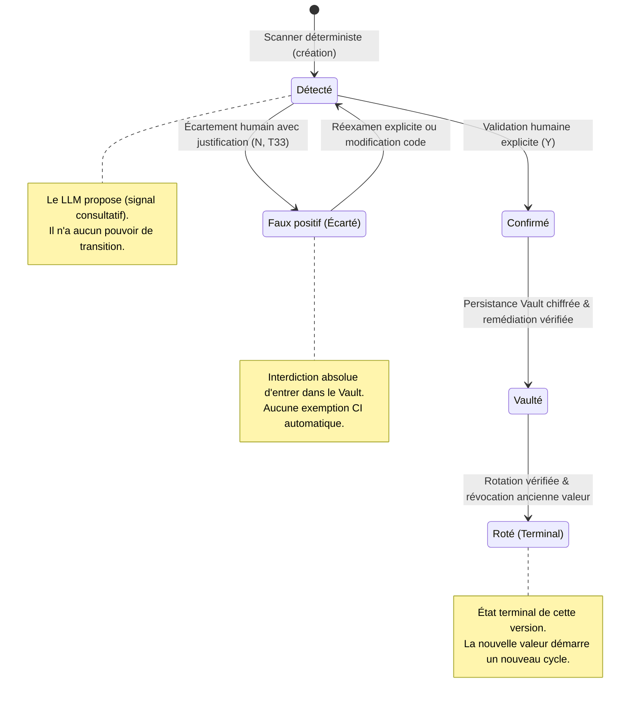

# ADR-006 — Table d'états et transitions du cycle de vie d'un secret

Statut : proposé. Ticket : #115, sous-ticket du grand ticket #40 « États du secret dans le Vault ».
Porteur : C · Relecteur : B · Sprint : S2.
Précédents : [ADR-001](001-finding-et-etats.md) (Finding v1 et états), [ADR-003](003-serveur-mcp.md) (serveur MCP), contrat [Finding v1](../contracts/finding.md) (#14), journal des rejets LLM [llm-rejections.md](../llm-rejections.md) (#33).

---

## Contexte

Dans Heimdall, un secret qui est passé par un commit est considéré comme **définitivement compromis**, même si le développeur le retire immédiatement après. Pour garantir la sécurité des dépôts et la traçabilité des interventions, le cycle de vie d'un secret doit être strictement encadré : `détecté -> confirmé -> vaulté -> roté`.

Le ticket #14 a posé le schéma JSON et le diagramme d'états de haut niveau du `Finding`. Cependant :
1. Le Vault doit formaliser et valider la **matrice complète des transitions autorisées et interdites**, garantissant qu'aucun contournement (ex. passage direct de `détecté` à `roté` sans confirmation humaine ni chiffrement) n'est possible ;
2. Le traitement des faux positifs (état « écarté » / `faux_positif`) doit être formellement tranché et articulé avec le journal des rejets du LLM (ticket #33) et la validation humaine (ticket #32) ;
3. Les sous-tickets suivants (#116 empreinte HMAC, #117 API de transition, #118 tests des transitions interdites) nécessitent un socle contractuel et logiciel unifié.

---

## Décisions

### 1. États canoniques et chaîne nominale

Le cycle de vie comporte cinq états formels, alignés à 100 % sur le contrat Finding v1 du ticket #14 :

- **`detecte` (Détecté)** : Le secret candidat a été repéré par le scanner déterministe (expressions régulières + seuil d'entropie de Shannon). Tout nouveau Finding commence obligatoirement dans cet état (`INITIAL_STATE = "detecte"`).
- **`confirme` (Confirmé)** : L'opérateur humain a validé explicitement le candidat comme étant un secret réel lors de la revue interactive dans le terminal (action `Y`).
- **`vaulte` (Vaulté)** : Le secret a été transmis au Vault, chiffré au repos (AES-256-GCM enveloppé par DEK unique) avec confirmation de persistance, et la remédiation locale a été vérifiée (remplacement par variable d'environnement, exclusion dans `.gitignore`, génération de `.env.example`).
- **`rote` (Roté)** : La valeur du secret a fait l'objet d'une rotation effective vérifiée par le composant responsable, et l'ancienne valeur a été révoquée et rendue inutilisable. Cet état est **terminal** pour cette version du secret.
- **`faux_positif` (Faux positif / Écarté)** : Le candidat a été explicitement rejeté par l'opérateur humain (action `N`). L'alias métier `ecarte` est reconnu comme synonyme d'entrée vers `faux_positif`.

La chaîne nominale de remédiation d'un secret est strictement linéaire :
$$\text{detecte} \longrightarrow \text{confirme} \longrightarrow \text{vaulte} \longrightarrow \text{rote}$$

---

### 2. Matrice exhaustive des transitions autorisées et interdites

L'espace complet des transitions entre les 5 états forme une matrice $5 \times 5 = 25$ combinaisons. Seules **5 transitions** sont autorisées. Toutes les **20 autres transitions** sont strictement interdites et échouent en mode *fail-closed* :

| État source | Cibles autorisées | Cibles interdites | Justification sécurité des interdictions |
|---|---|---|---|
| `detecte` | `confirme`, `faux_positif` | `detecte`, `vaulte`, `rote` | **detecte → vaulte interdit** : impossible de court-circuiter la confirmation humaine (évite d'injecter des données erronées dans le Vault). **detecte → rote interdit** : impossible de roter un secret non confirmé ni stocké. **detecte → detecte interdit** : pas de transition réflexive d'avancement. |
| `confirme` | `vaulte` | `detecte`, `confirme`, `faux_positif`, `rote` | **confirme → detecte interdit** : régression arrière interdite. **confirme → faux_positif interdit** : contradiction de qualification ; un secret confirmé ne peut pas être écarté sans nouveau scan à la source. **confirme → rote interdit** : impossible de roter avant persistance dans le Vault. **confirme → confirme interdit** : réflexif. |
| `vaulte` | `rote` | `detecte`, `confirme`, `vaulte`, `faux_positif` | **vaulte → detecte / confirme interdit** : régression interdite ; un secret qui a atteint le Vault ou Git est compromis. **vaulte → faux_positif interdit** : un secret vaulté est reconnu sensible au repos, il ne peut être déclassé. **vaulte → vaulte interdit** : réflexif. |
| `rote` | *(aucune)* | `detecte`, `confirme`, `vaulte`, `rote`, `faux_positif` | **État terminal** : la version est révoquée. Toute modification ou nouvelle valeur du secret doit commencer un cycle vierge et indépendant. |
| `faux_positif` | `detecte` | `confirme`, `vaulte`, `rote`, `faux_positif` | **faux_positif → confirme interdit** : doit obligatoirement repasser par `detecte` pour qualification. **faux_positif → vaulte interdit** : un faux positif ne doit JAMAIS entrer dans le Vault. **faux_positif → rote interdit** : aucun secret à roter. **faux_positif → faux_positif interdit** : réflexif. |

Les tables `ALLOWED_TRANSITIONS` et `FORBIDDEN_TRANSITION_REASONS` sont encapsulées dans des `types.MappingProxyType` immuables afin de prévenir toute falsification dynamique ou pollution mémoire (interdiction de mutation runtime).

---

### 3. Décision sur le traitement du faux positif (état « écarté » en lien avec #33)

Le sous-ticket demande de trancher explicitement le sort d'un faux positif. Les règles retenues sont les suivantes :

1. **Rôle strictement consultatif du LLM (#33)** :
   Le LLM local (Ollama) ne dispose d'aucun droit de décision. Lorsqu'il suggère qu'un candidat est un faux positif (`source: llm`), sa proposition est journalisée de manière durable dans le journal local sécurisé `$XDG_STATE_HOME/heimdall/llm-rejections.jsonl` avec le motif fermé `JUSTIFICATION = "faux_positif_propose_par_llm_validation_humaine_requise"`. Aucun texte arbitraire du LLM ni extrait en clair n'est conservé, prévenant toute injection de prompt ou fuite de secret.

2. **Validation humaine obligatoire (#32)** :
   Un Finding ne peut passer à l'état `faux_positif` (écarté) que par une **action humaine explicite** dans la boucle terminale (`N` / ignorer). Cette décision est consignée dans le `DecisionJournal` avec horodatage UTC non répudiable.

3. **Interdiction formelle de stockage dans le Vault** :
   La transition `faux_positif -> vaulte` est formellement interdite. Le Vault héberge exclusivement les secrets confirmés chiffrés. Autoriser l'écriture d'un faux positif dans le Vault exposerait le système à :
   - une pollution de la base et un épuisement délibéré des quotas de stockage ;
   - une fuite de métadonnées de projet dans le store sécurisé ;
   - une confusion d'audit lors des réexamens de sécurité.

4. **Aucune exemption CI automatique** :
   En intégration continue (`heimdall scan --ci`), un Finding ayant localement l'état `faux_positif` **ne constitue pas une dispense** : si une chaîne suspecte en clair est détectée, le pipeline échoue *fail-closed*. Seule une exclusion explicite via l'allowlist déterministe cryptographique (`heimdall.toml`), revue et commitée par les pairs (#24), autorise l'ignorer en CI.

5. **Réexamen et cycle ultérieur** :
   La seule transition sortante autorisée pour un secret écarté est `faux_positif -> detecte`. Elle intervient soit lors d'une commande explicite de réexamen de l'opérateur, soit lorsqu'une modification ultérieure du contenu produit un nouveau Finding indépendant.

---

### 4. Absence de régression arrière et terminalité

- Une fois qu'un secret est passé à l'état `confirme`, il est acté comme réel. Il ne peut plus rétrograder à `detecte`.
- Une fois qu'un secret est à l'état `vaulte`, il est acté qu'il a existé dans l'environnement. Même si le développeur le retire de son code local, ce secret est considéré compromis tant qu'il n'est pas roté (`vaulte -> rote`). Il ne peut en aucun cas redevenir `detecte`, `confirme` ou `faux_positif`.
- L'état `rote` scelle la fin de vie de cette version du secret. Aucune transition sortante n'existe depuis `rote`.

---

### 5. Idempotence et absence de transition réflexive

Une requête demandant de passer un secret d'un état $S$ au même état $S$ (ex. `vaulte -> vaulte`) n'est pas une transition d'avancement du cycle de vie. Re-consulter ou re-valider un état actuel est une lecture idempotente, mais toute tentative de solliciter une mutation d'état réflexive est refusée (`InvalidTransitionError`).

---

### 6. Canonicalisation obligatoire et interdiction de persistance des alias

Le contrat Finding v1 ([`docs/contracts/finding.md`](../contracts/finding.md)) et le schéma JSON ([`schemas/finding.schema.json`](../../schemas/finding.schema.json)) n'autorisent strictement que les 5 états canoniques (`detecte`, `confirme`, `vaulte`, `rote`, `faux_positif`).

- Les alias (`ecarte`, `ecarté`, `discarded`) ainsi que les variations de casse ou d'espaces ne sont tolérés qu'en entrée aux frontières d'interface (CLI, paramètres de requête HTTP) pour l'ergonomie.
- **Règle de persistance** : Tout mutateur d'état (route API dans #117, store Vault SQLite ou écriture de Finding) **DOIT obligatoirement appeler `canonicalize_state()`** et persister exclusivement l'identifiant canonique résultant.
- Il est **formellement interdit de persister un alias** en base de données ou dans un fichier de sortie.

---

### 7. Non-reflet des entrées et sécurité Invariant 8

Afin de respecter l'invariant 8 (« Aucun secret dans les logs, exceptions ou repr ») :
- `UnknownStateError` renvoie un message d'erreur strictement statique : `"État de cycle de vie inconnu."`.
- L'objet ou la chaîne non fiable fournie en entrée n'est jamais acceptée ni stockée sur l'instance d'exception (`UnknownStateError.__init__(self)` n'accepte aucun argument pour éliminer tout risque de reflet ou fuite de secret).
- Cela empêche qu'un secret, un token d'API ou un payload hostile (ex. `sk_l****\nINJECTED`) passé par erreur ou malice à la place d'un état ne soit réémis dans une réponse HTTP, un log serveur ou un journal d'audit.
- Les entrées sont bornées défensivement à `MAX_STATE_CHARS = 64` caractères pour écarter tout risque de saturation mémoire (DoS).

---

### 8. Mise en œuvre de l'API de transition (#117)

Le sous-ticket #117 branche la matrice dans le serveur Vault sans élargir le
contrat des états persistés :

- **Route** : `POST /api/v1/secrets/{project}/{env}/{name}/transition`, même
  authentification que les autres routes Vault (401, 403 avant toute recherche,
  404 pour un secret absent). Le corps est strict et ne porte que
  `target_status` ; l'état source est toujours lu côté serveur, ce qui interdit
  au client de forger un état de départ.
- **Application de la matrice** : `validate_transition()` est appelée sur l'état
  réellement persisté. Les cinq états #115 sont acceptés comme cible déclarée,
  mais seuls `vaulte` et `rote` sont persistables
  (`PERSISTED_STATUSES`) : la seule transition API réussie est actuellement
  `vaulte -> rote`. Toute autre demande (réflexive, régression, cible inconnue,
  alias non canonique) retourne 400 avec le message statique du contrat, sans
  refléter l'entrée.
- **Réponse** : `SecretTransitionResult` se limite à `project`, `env`, `name`,
  `previous_status` et `status`, avec `Cache-Control: no-store` ; ni valeur,
  ni empreinte, ni acteur n'est exposé. Le schéma OpenAPI `SecretStatus`
  (`vaulte`/`rote`) reste inchangé ; les cinq états sont déclarés séparément
  dans `SecretLifecycleState` pour le corps de requête.
- **Journal** : table `secret_transitions` (SQLite) et journal par projet
  (mémoire) avec `occurred_at`, identité, acteur, `previous_status`,
  `new_status`. L'horodatage est toujours généré côté serveur par
  `get_iso_timestamp()` ; aucun paramètre d'API ne permet de le fournir ou de
  le forger. L'UPDATE conditionnel de `secrets.status` et l'INSERT du journal
  partagent la même transaction `BEGIN IMMEDIATE` : une transition acceptée ne
  peut pas manquer au journal, et deux transitions concurrentes ne peuvent pas
  réussir toutes les deux. **Cette garantie d'atomicité (état + journal) et de
  compare-and-set est portée par le backend SQLite** (backend de production) ;
  le backend mémoire, réservé aux tests et au développement mono-processus, n'emprunte
  aucune transaction partagée : il repose sur le verrou de l'instance et un
  journal borné, sans transaction ni CAS inter-processus. L'atomicité
  inter-processus et le CAS ne sont donc garantis que par le backend SQLite.
  Un compare-and-set perdant (`rowcount != 1`) lève
  `TransitionConcurrencyError`, mappée en 400 statique par la route, comme les
  transitions interdites. L'acteur est normalisé sur `^key_[0-9a-f]{32}$` ;
  toute autre valeur devient `unknown`, donc aucune donnée arbitraire ou
  sensible n'est persistée. La rétention est bornée **par projet** à
  `MAX_SECRET_TRANSITIONS` (10 000) : une inondation d'un projet ne peut pas
  évincer le journal d'un autre, et chaque purge locale émet un avertissement
  d'exploitation. L'absence de clé étrangère vers `secrets` conserve
  l'historique après suppression. Aucune route HTTP n'expose le journal.
- **Après `rote`** : l'état est terminal (toute transition retourne 400). La
  lecture de l'ancienne valeur via `GET /api/v1/secrets/{project}/{env}/{name}`
  retourne 404 ; `GET .../state` continue d'exposer `rote` sans valeur. Le
  statut lu est canonicalisé avant la garde : une valeur corrompue en base
  (casse, espaces, état inconnu) retourne 404 sans restituer la valeur.

La vérification exhaustive des 20 transitions interdites contre l'API HTTP
est portée et prouvée par #118 (`tests/test_vault_transitions_forbidden.py`,
140 tests paramétrés, `docs/t118-samm.md`) ; #117 pose la route, l'application
de la matrice et le journal atomique.

## Conséquences et limites

- **Sécurité et robustesse** : l'API #117 et les mutateurs du store Vault appellent obligatoirement `validate_transition()` et ne persistent que le statut canonique, éliminant tout risque de contournement ou de désynchronisation entre la documentation, le contrat JSON et le comportement d'exécution.
- **Confinement cryptographique** : Le module `heimdall/vault/transitions.py` est 100 % déterministe et n'utilise que la bibliothèque standard Python. Il respecte l'invariant 5 et n'importe aucune primitive de `cryptography` ou `argon2`.
- **Découpage des sous-tickets (socle vs application)** :
  - Le ticket **#115** livre le socle formel contractuel, les tables immuables et la bibliothèque de validation logicielle (`validate_transition`, `canonicalize_state`).
  - Le ticket **#117** branche ce socle dans l'endpoint FastAPI `/api/v1/secrets/.../transition` et dans les mutateurs du store Vault, avec le journal atomique des transitions (voir §8).
  - La vérification automatisée de bout en bout des 20 transitions interdites contre l'API HTTP du Vault est livrée et prouvée par le sous-ticket **#118** (`tests/test_vault_transitions_forbidden.py` : 140 tests paramétrés couvrant la matrice, les deux stores et l'API HTTP, avec une couverture mesurée à 100 % de la machine d'états ; voir `docs/t118-samm.md`).
