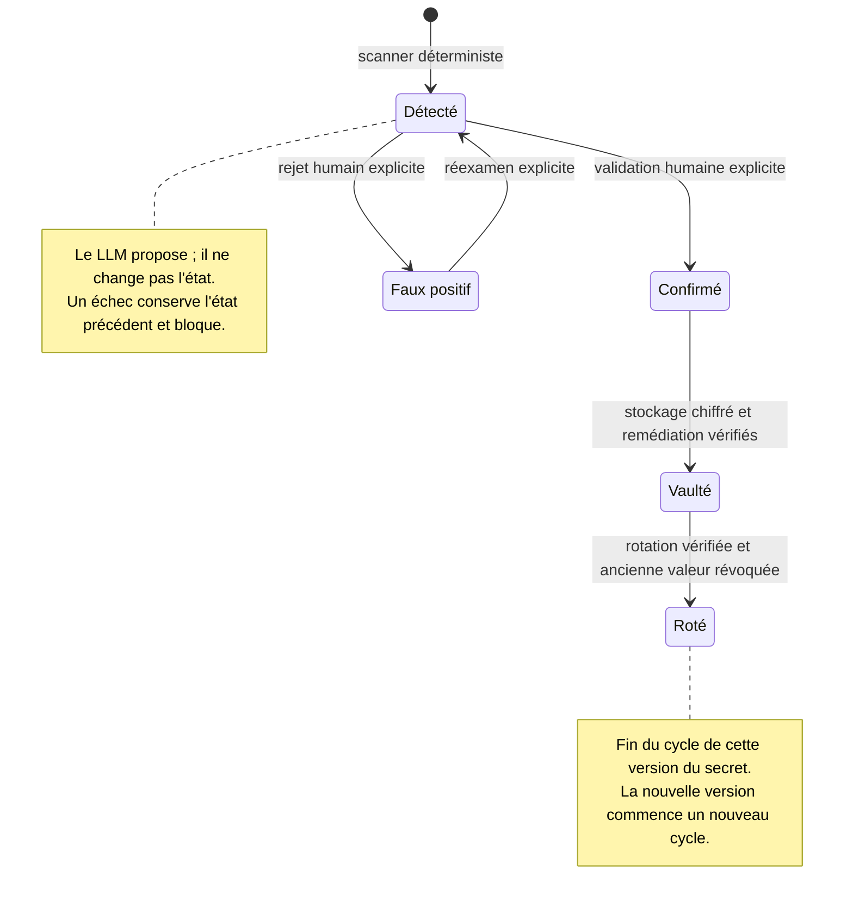

# Contrat Finding v1

Ticket #14. Schéma : [finding.schema.json](../../schemas/finding.schema.json).
Décisions : [ADR-001](../adr/001-finding-et-etats.md).

| Champ | Contrat |
| --- | --- |
| `file` | Chemin relatif au dépôt avec `/`, 1 à 4096 caractères, sans chemin absolu, segment vide, segment `.` ou `..`, ni `/` final |
| `line` | Entier supérieur ou égal à 1 |
| `type` | Catégorie en snake_case ASCII, 1 à 64 caractères |
| `entropy` | Nombre entre 0 et 8, Shannon sur les octets UTF-8 du candidat |
| `snippet_hash` | HMAC-SHA-256, 64 caractères hexadécimaux minuscules |
| `status` | `detecte`, `confirme`, `vaulte`, `rote`, `faux_positif` |
| `source` | `regex`, `entropy`, `llm` ; signal et non autorité |

Tous les champs sont obligatoires ; les propriétés inconnues sont rejetées.
Le JSON Schema draft 2020-12 est validé hors ligne : `$schema` est un
identifiant de dialecte, sans obligation de télécharger ce document.
`$id` est l'identifiant stable du contrat ; il ne constitue pas un endpoint à
télécharger. Les consommateurs doivent enregistrer le schéma localement.
Les chaînes sont ancrées par `(?![\s\S])` pour imposer une vraie fin de chaîne,
sans l'ambiguïté de `$` devant un saut de ligne final. Les chemins excluent
aussi les séparateurs de ligne Unicode U+2028 et U+2029.

## Machine d'états



| Origine | Destination autorisée | Condition |
| --- | --- | --- |
| Initialisation | `detecte` | Création par le scanner ; le JSON seul ne prouve pas cette origine |
| `detecte` | `confirme` | Le développeur confirme le candidat |
| `detecte` | `faux_positif` | Le développeur rejette explicitement le candidat ; décision journalisée sans secret |
| `faux_positif` | `detecte` | Réexamen explicite ; une modification du contenu crée un nouveau Finding |
| `confirme` | `vaulte` | Vault confirme la persistance chiffrée et la CLI vérifie le remplacement et la protection de `.env` |
| `vaulte` | `rote` | Nouvelle valeur stockée et ancienne valeur révoquée ; preuve vérifiée par le composant responsable |

**Toutes les autres transitions sont interdites**, notamment `detecte → vaulte`,
`detecte → rote`, `faux_positif → confirme`, `confirme → faux_positif`,
`vaulte → confirme` et toute sortie de `rote`. Relire un état inchangé est
possible, mais n'est pas une transition. Un échec de stockage, de remédiation
ou de rotation ne permet pas d'avancer dans le cycle. Les retries doivent
être idempotents et contrôlés par le composant responsable.

En CI, le LLM n'a aucun pouvoir et une valeur en clair détectée bloque,
même si un ancien Finding indique `vaulte`, `rote` ou `faux_positif`.

## Exemples et vérification

[examples.json](../../schemas/examples/finding/examples.json) contient des
instantanés valides et invalides avec les motifs de rejet. Les empreintes sont
des placeholders synthétiques ; aucune valeur de secret n'est incluse.

Avec Python 3.10 ou supérieur, depuis la racine du dépôt :

```powershell
python -m venv .venv
.venv/Scripts/python.exe -m pip install -r tests/contracts/requirements.txt
.venv/Scripts/python.exe -m unittest discover -s tests/contracts -v
```

Linux/macOS :

```sh
python3 -m venv .venv
.venv/bin/python -m pip install -r tests/contracts/requirements.txt
.venv/bin/python -m unittest discover -s tests/contracts -v
```

Le `.gitignore` accompagne uniquement ces tests : il exclut leur environnement
virtuel et les caches Python générés localement.

L'installation du validateur est une opération de développement. Les tests
et le contrat n'effectuent aucun appel réseau. Ils vérifient le schéma contre
le méta-schéma 2020-12, les exemples, les champs obligatoires, les bornes et les
chemins interdits. Ils ne certifient pas une implémentation des transitions.

## Relecture et preuve

- [ ] Membre A : diagramme et contrat relus
- [ ] Membre B : diagramme et contrat relus
- [ ] Membre C : diagramme et contrat relus
- [ ] Membre D : diagramme et contrat relus

Après commit, utiliser son SHA pour les liens permanents vers le schéma, le
diagramme et l'ADR (avec leurs lignes). Reporter ces preuves dans la feuille
SAMM avec le résultat des tests et le lien de la PR `Closes #14`. La validation
par les quatre membres et la relecture externe restent nécessaires.
