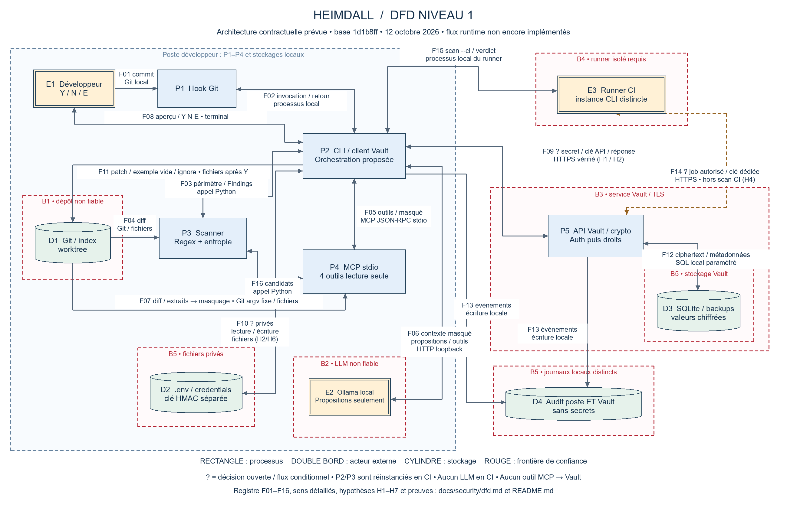

# DFD niveau 1 — #45

[Index et base de l'analyse](README.md). Diagramme logique sur une page,
12 éléments hors zones et légende ; les flèches sont des flux contractuels
prévus. Les flux conditionnels portent « ? ». Aucun serveur complet n'est
fourni par ce ticket.

Source éditable : [dfd.drawio](dfd.drawio). Ouvrir dans diagrams.net/draw.io,
modifier la page unique, puis exporter en PNG avec le fond blanc et toutes
les zones visibles. La source et l'image doivent être mises à jour ensemble.
L'export initial a été rendu depuis les mêmes cellules et coordonnées avec
Pillow ; l'inspection visuelle fait partie de la vérification documentaire.

## Éléments

| ID | Élément | Nature et responsabilité |
| --- | --- | --- |
| E1 | Développeur / collègue | Acteur externe ; commit, validation Y/N/E, récupération autorisée. |
| P1 | Hook Git | Processus local ; déclenche la CLI et propage le refus. Ce contrôle local est contournable. |
| P2 | CLI / client / orchestration | Processus ; scanner, échange Ollama, client MCP, décision humaine et écritures. H2/H3/H5 restent à trancher. |
| P3 | Scanner | Processus déterministe ; regex/entropie ; Finding sans secret brut. |
| P4 | Serveur MCP | Processus enfant stdio ; quatre outils en lecture seule, garde de chemin et sorties masquées. |
| E2 | Ollama | Service local traité comme acteur externe non fiable ; propose sans autorité. |
| D1 | Dépôt / index / worktree | Stockage non fiable : code, diff, noms, attributs, configuration Git. |
| D2 | Fichiers privés du poste | Stockage logique : `.env`, credential API et clé HMAC dans des fichiers distincts ; clés hors dépôt. |
| P5 | API Vault / crypto | Processus authentifiant et autorisant avant lecture ; pas de route de rotation en v1. |
| D3 | SQLite / sauvegardes | Stockage prévu : valeurs chiffrées, métadonnées, vérificateurs de clés ; KEK hors base. |
| D4 | Journaux d'audit | Stockages logiques séparés sur poste et Vault ; événements sans valeurs sensibles. Aucune centralisation réseau implicite. |
| E3 | Runner CI | Acteur externe d'exécution ; lance sa propre instance P2/P3, jamais celle du poste. |

Les rectangles sont des processus, les cylindres des stockages et les
boîtes à double bord des acteurs externes. Les zones rouges B1–B5 sont
expliquées dans [les frontières](assets-and-boundaries.md). Un appel local
reste une frontière lorsque la donnée ou l'autorité change.

## Registre des flux

Les doubles flèches décrivent deux sens ; les données de chaque sens sont
explicites ci-dessous. Le masque ne rend pas le texte fiable.

| Flux | Source → destination | Données et protocole | Condition / statut |
| --- | --- | --- | --- |
| F01 | E1 → P1 | Tentative de commit ; invocation locale Git/hook. | Hook prévu, non livré. |
| F02 | P1 ↔ P2 | Invocation CLI par processus local ; retour code 0/1/2. | CLI actuelle : code 2 ; hook à implémenter (#19 pour son exigence). |
| F03 | P2 ↔ P3 | Racine/périmètre ; Findings JSON et verdict ; appel de fonction Python. | #22 ; 0 propre, 1 secret, 2 erreur ; couverture incomplète ne vaut pas succès. |
| F04 | D1 → P3 | Diff/index ou dépôt initial ; lecture fichiers / Git argv fixe. | #22 ; entrées contenant potentiellement des secrets bruts. |
| F05 | P2 ↔ P4 | Appels aux quatre outils, sorties masquées, candidats, aperçus et erreurs ; MCP JSON-RPC sur stdio. | #27 ; pas de secret ni de patch réel sérialisé vers le LLM. |
| F06 | P2 ↔ E2 | Contexte masqué/résultats d'outils ; propositions et demandes d'outils ; HTTP loopback Ollama. | #28 ; médiation P2, pas de socket MCP ni de liaison directe E2 → P4. Désactivé en CI. |
| F07 | D1 → P4 | Extraits/diff bruts lus puis masqués ; fichiers et Git avec argv fixe, sans shell, `--no-ext-diff --no-textconv`. | #27 ; le masquage doit précéder F05 et F06. |
| F08 | E1 ↔ P2 | Aperçu masqué, choix Y/N/E ; terminal local. | #32 ; l'humain peut saisir une édition sensible : ni historique ni logs de saisie. |
| F09 | P2 ↔ P5 | HTTPS : header `X-Heimdall-API-Key`, POST JSON secret ; GET valeur autorisée / état / health, métadonnées, erreurs et en-têtes. | #25/#26 ; secret en clair applicatif, chiffré sur transport. Loopback ; distant conditionnel H1 ; destinataire H2 ouvert. |
| F10 | P2 ↔ D2 | Lecture credential/HMAC et lecture/écriture `.env` via fichiers locaux protégés. | #26/#32, H2/H6 ; fichiers distincts ; aucun credential en argument CLI. |
| F11 | P2 → D1 | Code remédié, `.env.example` sans valeur, `.gitignore` ; écritures fichiers locales contrôlées. | #30/#32 ; après validation et recontrôle du snapshot ; pas d'écriture par MCP. |
| F12 | P5 ↔ D3 | SQL local paramétré : ciphertext, métadonnées et vérificateurs ; retour des mêmes catégories. | #25 ; aucun secret brut persistant, KEK distincte hors base. |
| F13 | P2 et P5 → D4 | Événements de rejet/décision/accès ; écritures locales d'audit. | #33, #25, #19 ; deux lieux distincts, corrélation sans contenu sensible. |
| F14 | E3 ↔ P5 | HTTPS clé dédiée et réponses Vault selon droits ; éventuelle valeur destinée au job. | **Conditionnel H4** ; pas d'appel actuel, pas nécessaire à `scan --ci`, interdit aux jobs non fiables. |
| F15 | E3 ↔ P2 | Processus local `heimdall scan --ci`, checkout local D1 ; verdict et code de sortie. | Instance CLI/scanner du runner ; sans LLM, sans décision humaine, sans Vault requis. |
| F16 | P4 ↔ P3 | Périmètre/candidats/snapshot ; appel Python proposé pour `list_candidates`. | #22/#27 ; partage de logique, isolation réelle interprocessus à préciser en implémentation. |

P3 et P4 doivent mémoriser au minimum les informations nécessaires au scan,
avec durée de vie bornée. Une valeur brute ne fait pas partie du Finding.
Le calcul/retrieval du patch réel reste interne au code de remédiation (H3) ;
la flèche F05 ne lui invente aucun canal réseau.

Le DFD concerne Heimdall à l'exécution. Le clone Git, les téléchargements de
dépendances et la plateforme GitHub appartiennent à la chaîne de développement,
étudiée sous CI dans STRIDE ; ils ne sont pas des appels Internet autorisés
pour Heimdall. Le runner `self-hosted` actuel exécute les tests de contrat,
pas une protection `scan --ci` déjà opérationnelle.
